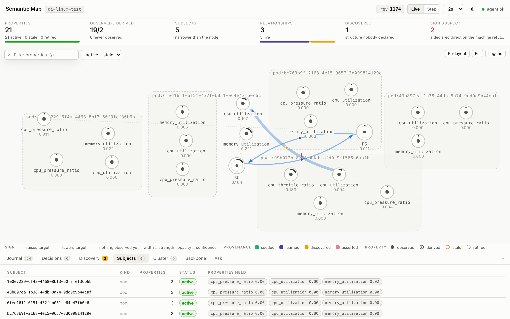
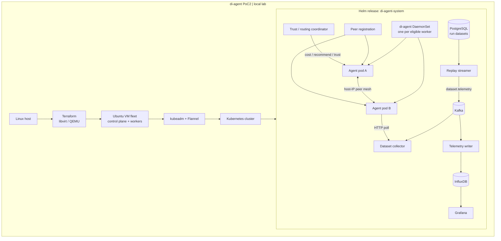
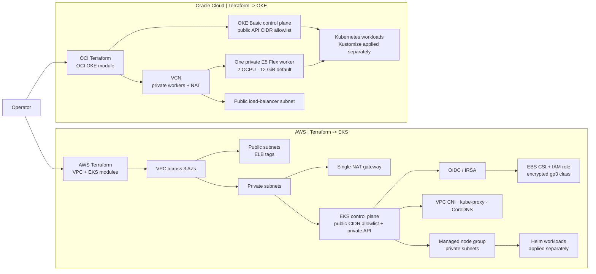
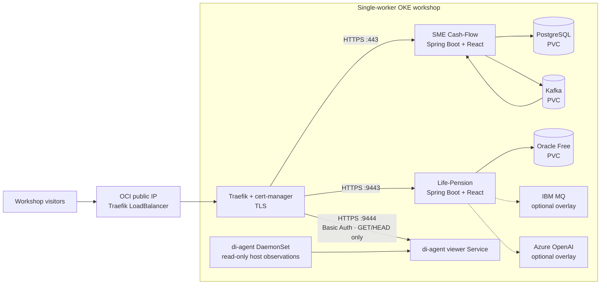
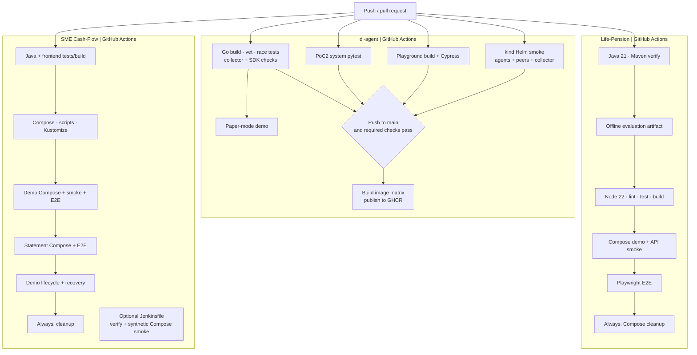

# di-agent

[](https://github.com/DiyazY/di-agent/actions/workflows/ci.yml)

**Context-Aware Agent for Decentralized Edge Orchestration**

Implementation artifact for the dissertation *A Context-Aware Agentic Framework for Decentralized Edge Computing* (Tampere University, Diyaz Yakubov, supervised by David Hästbacka and Sergio Moreschini). Funded by Business Finland — Industry X and 6GSoft projects.

---

## What this is

`di-agent` is an orchestration agent for resource-constrained edge nodes (Raspberry Pi 4 and equivalent). Every node runs its own agent, and each agent models only the machine it runs on. Questions about the whole cluster go to peers, not to a central control plane.

The agent reasons against the **Semantic Map**, a live model of one system's state:

- **Properties.** The map holds what the node and each workload on it (a pod, a systemd unit, any producer that names a subject) are doing. A property is admitted when it is first observed, marked stale when it goes silent, and retired when it stays silent. If it is observed again, it comes back.
- **Relationships.** Relationships between properties are learned from paired observations. A freshly started agent reports that it does not know what a relationship is worth yet, instead of reporting a constant nobody measured. The proposer also *discovers* relationships that nobody declared, which an operator then confirms.
- **Answers you can trace.** `GET /state` says what the system is doing right now. `GET /state/estimate` answers "what happens to X if this workload grows, or leaves". Every answer carries a decision id whose inputs can be replayed afterwards.

The code is built on five swappable contracts (Collector, Ontology, Reasoner, Proposer, Tuner) with a compliance suite for each. The shipped profile is `edge-minimal`: a single static Go binary with no runtime dependencies.



*The console on a single-node k0s VM. [`docs/real-node-run.md`](docs/real-node-run.md) walks through the run.*

---

## Research context

This repository covers **Publications P6 and P7** of the dissertation:

| Publication | Title | Status |
|-------------|-------|--------|
| P6 | Semantic Map & Context-Aware Agent Architecture | In progress |
| P7 | Decentralized Agentic Framework (P2P coordination) | Planned — Year 3 |

The agent synthesises findings from five prior publications:

| Publication | What it contributes to di-agent |
|-------------|--------------------------------|
| P1 — [Performance & Resource Efficiency](https://link.springer.com/chapter/10.1007/978-3-031-84617-5_7) | Evidence behind the declared propositions; the workloads the convergence study replays per distribution |
| P2 — [Security, Resilience & Maintainability](https://link.springer.com/chapter/10.1007/978-3-031-84617-5_8) | Evidence for the constructs a running cluster cannot move, which is why they stay at selection time. Recovery time constants |
| P3 — [Di-Select](https://link.springer.com/article/10.1007/s10586-026-06269-5) (*Cluster Computing*, 2026) | Backbone topology: 7 constructs, 15 causal propositions (P1–P15) |
| P4 — Energy Analysis, DVFS / CPU microarchitecture (ESOCC 2026, to appear) | Why energy is *not* routed: the model is calibrated for one hardware class and no node here measures a joule |
| P5 — Overhead Decomposition, k0s cgroup analysis (ESOCC 2026, to appear) | Per-container evidence that the orchestration tax is real and small; k0s-only |

---

## Related repositories

| Repository | Description |
|------------|-------------|
| [DiyazY/iot-edge](https://github.com/DiyazY/iot-edge) | Experimental infrastructure for P1 & P2 — Ansible playbooks, k-bench configs, raw benchmark results across 5 Kubernetes distributions on an RPi4 cluster |
| [DiyazY/di-select](https://github.com/DiyazY/di-select) | Grounded theory analysis for P3 — open/axial/selective coding, 15 causal propositions, trade-off patterns |
| [DiyazY/KD-Select](https://github.com/DiyazY/KD-Select) | Extended Di-Select for P3 — AI-driven implementation design, Neo4j schema, RAG pipeline, scraped knowledge base |

---

## Dissertation arc

```
Phase 1 — Foundation (complete)       Phase 2 — Agent's Brain      Phase 3 — Decentralized
──────────────────────────────────    ─────────────────────────    ───────────────────────
P1: Performance benchmarks            P6: Semantic Map +            P7: P2P coordination
P2: Security & resilience                 Context-Aware Agent           Gossip discovery
P3: Di-Select selection framework         (this repo)                   Market-based offload
P4: Energy (DVFS model)                                                 Fault-tolerant handoff
P5: Overhead decomposition
```

---

## Status

**Research prototype, open for testing.** The `edge-minimal` daemon, the state model (subjects, lifecycle, discovery, counterfactual estimates), the `mapctl` CLI, the embedded operator console, peer coordination and the natural-language `/explain` layer are all implemented and covered by CI. The `cloud-full` profile (graph database, RDF/OWL ontology, Bayesian reasoner) is planned and does not exist yet.

There is **no authentication** on any endpoint. Run it on a trusted network only. See [`OPERATING.md`](OPERATING.md#read-this-first).

## Quick start

Go 1.22+ is the only hard requirement.

```bash
git clone https://github.com/DiyazY/di-agent && cd di-agent/semantic-map/go
go build ./... && go test ./...     # verify the checkout

./dev.sh demo              # guided tour: build, start, scenarios, operator console
```

**Testing it?** [`TESTING.md`](TESTING.md) has a 15-minute walkthrough that works from a fresh clone, what to look at, and how to report what you find.

The parquet replay tool (`./dev.sh replay …`) replays the dissertation's Netdata dataset. That dataset is **not part of this repository**, so replay needs `--data-dir` pointing at a copy of it. Everything else runs without it.

### Shared Devbox Kubernetes lab

The optional workspace workflow manages synthetic demos for this repository,
Life-Pension-workspace and SME-Cash-Flow-Copilot. Clone `di-agent` and place the
other two repositories beside it; `pull` can clone missing repositories there.
Install Devbox, Docker, kind, kubectl and Helm on the host. Docker access grants
host-level privileges. The di-agent image build currently requires Linux x86-64.
See the installation guides for [Devbox](https://www.jetify.com/docs/devbox/),
[Docker](https://docs.docker.com/engine/install/), [kind](https://kind.sigs.k8s.io/docs/user/quick-start/#installation),
[kubectl](https://kubernetes.io/docs/tasks/tools/) and [Helm](https://helm.sh/docs/intro/install/).

```sh
devbox run setup       # check tools and ask before creating a dedicated kind cluster
devbox run pull        # clone missing repositories; fast-forward clean main branches
devbox run deploy-all  # build and deploy all three demos
devbox run deploy di-agent
devbox run deploy life-pension
devbox run deploy sme-cashflow
devbox run deploy dataset-collector  # or telemetry-writer, after deploying di-agent
```

These commands are also available from the two finance repositories when
`di-agent` is a sibling directory. Their existing `setup` also runs `npm ci`.
`pull` skips dirty, detached, and non-main checkouts and reports an error;
it never switches branches or discards changes.

Setup creates `devbox-workspace` with one worker and a private kubeconfig under
`.devbox/workspace`, without changing the current kubectl context. It refuses to
adopt an existing cluster or a replacement cluster. Deployments use only this
cluster: the di-agent Helm chart uses disposable telemetry storage and disables
the dataset replay; the finance demos use their existing Kustomize overlays and
persistent volumes. Deploying `di-agent` upgrades the whole Helm release;
`dataset-collector` and `telemetry-writer` update individual chart images.
Life-Pension demo credentials are generated privately under
`.devbox/workspace/life-secrets`; do not share them. If its Secret is lost while
its volume exists, restore the original database credential rather than resetting
the data. SME uses the public demo credentials in its overlay.

To access a finance demo from the di-agent repository root, forward its service:

```sh
kubectl --kubeconfig .devbox/workspace/kubeconfig -n life-pension-demo port-forward service/workspace 8089:8080
# Or, in a separate terminal:
kubectl --kubeconfig .devbox/workspace/kubeconfig -n sme-cashflow port-forward service/copilot 8083:8080
```

Open the corresponding localhost port. Life-Pension uses the `adviser` account
and the private `adviser-password` file above; SME uses `developer` /
`local-demo-password`. Stop a forward with Ctrl-C.

The lab uses synthetic data, has no production security guarantees, and can
consume significant CPU, memory, disk space and network traffic. It does not
deploy cloud, Oracle, MQ or banking integrations. No automatic cleanup deletes
the cluster or its volumes. Telepresence swap is not included: the finance
apps are stateful single replicas, and the di-agent worker is host-networked;
intercepting them safely needs a separately designed development workflow.

## Documentation

| Document | Read it for |
| -------- | ----------- |
| [`TESTING.md`](TESTING.md) | **Trying it out?** A guided walkthrough from a fresh clone, what is in and out of scope, and how to report issues. |
| [`DEVELOPING.md`](DEVELOPING.md) | **Changing code?** Install, the inner loop, how to extend (collectors, MetricTypes, contracts, profiles, endpoints, explain tools), testing, conventions, troubleshooting. |
| [`docs/collectors.md`](docs/collectors.md) | **Adding a collector?** Write one in any language, certify it with `mapctl collector check`, and plug it in with one `sources.collectors` entry: the contract, the wire protocol, the producer rules, ownership, security, and worked examples (Python, Go, shell). |
| [`docs/real-node-run.md`](docs/real-node-run.md) | **What does it look like?** One run on a real Linux node with screenshots: what was admitted, discovered and learned, the counterfactual answers, and the problems the run exposed. |
| [`OPERATING.md`](OPERATING.md) | **Deploying it?** Security posture (read this first — there is no auth), resource footprint, systemd unit, health checks, monitoring, multi-node setup, upgrades, what it touches on your system. |
| [`semantic-map/ARCHITECTURE.md`](semantic-map/ARCHITECTURE.md) | The design record — layer map, component reference, request lifecycles, the five contracts and why, multigraph backbone, coordination, the natural-language layer. |
| [`semantic-map/README.md`](semantic-map/README.md) | Operational reference — project structure, endpoint table, daemon flags, compliance tests, structural initialization, PoC quickstart. |

### di-agent PoC2: Local Lab



### Terraform Infrastructure: AWS EKS and OCI OKE



### OCI Workshop Runtime: Three Applications



### CI Pipelines: di-agent, Life-Pension, and SME Cash-Flow



## License

MIT. See [`LICENSE`](LICENSE). Copyright © 2026 Tampere University.
