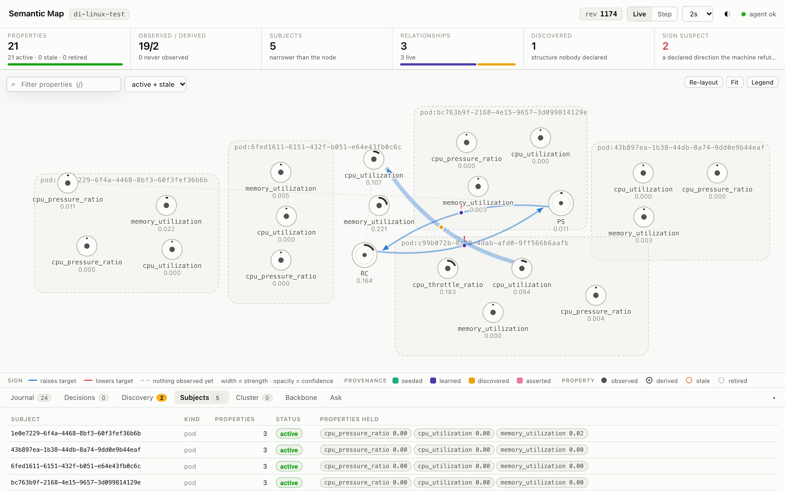
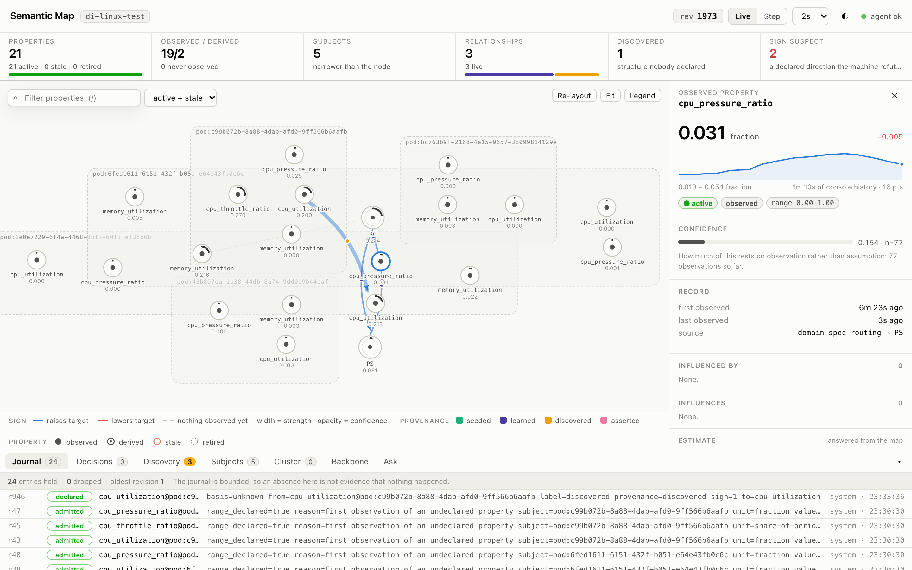
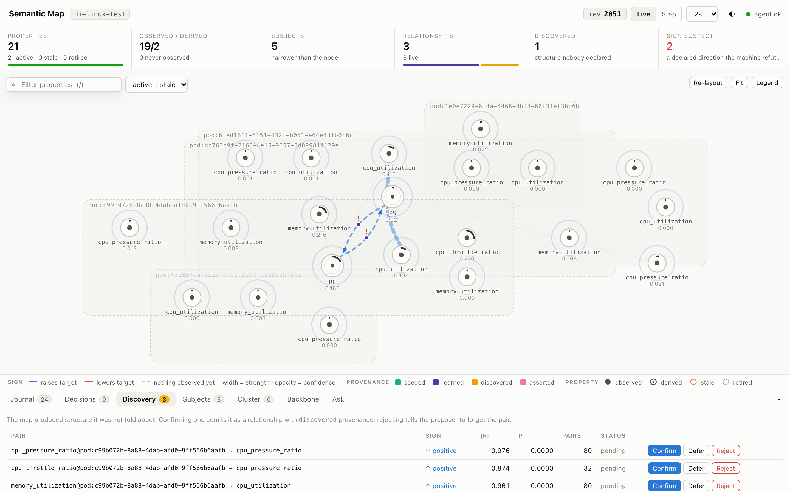
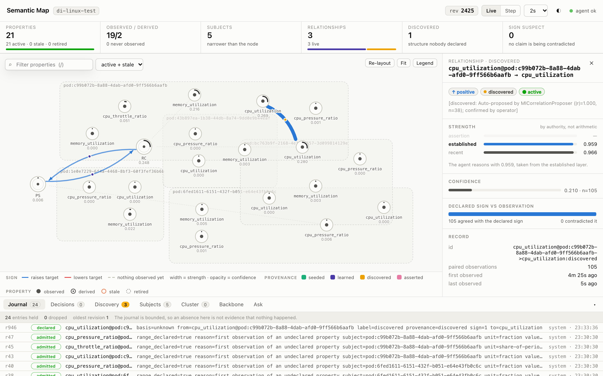
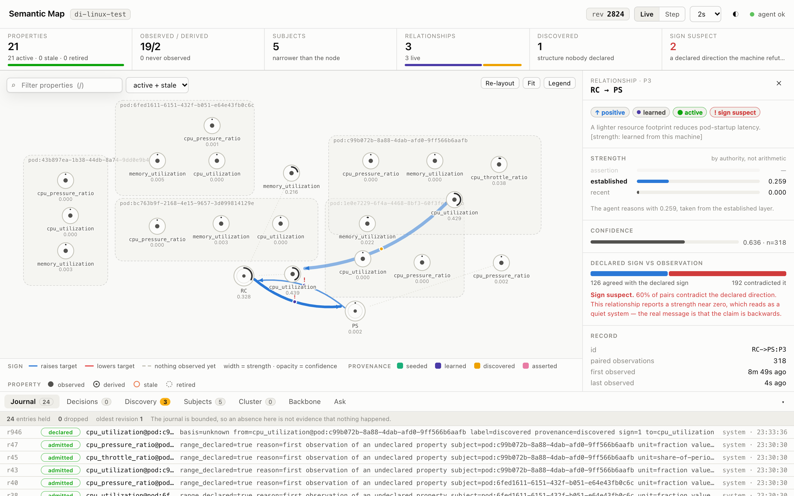

# A run on a real Linux node

This page shows the agent on one real machine: what it admitted, what it discovered,
what it learned, and what it answered. Everything here was captured from a running
agent, not from a scripted scenario. The aim is to show what the map looks like on a
node, including the parts that do not work well yet.

Captured 2026-10-15 with the build at `5a389b8` (`fix/real-node-gaps`, PR #19).

## The node

| | |
| --- | --- |
| Machine | Multipass VM, Ubuntu 24.04, arm64, 2 vCPU, 4 GB, kernel 6.8, cgroup v2 |
| Kubernetes | k0s v1.36.4, one node, cgroupfs driver |
| Agent | `sudo ./agent -addr 0.0.0.0:9090 -collect-interval 5s`, the cgroup collector, `domain_spec.json` from this repo |
| Workload | five pods: four from k0s (coredns, kube-proxy, kube-router, metrics-server) and `cycler`, below |

`cycler` gives the map something to see: 45 s of one busy core, then 45 s idle,
capped at one of the two CPUs.

```yaml
apiVersion: v1
kind: Pod
metadata: { name: cycler }
spec:
  containers:
  - name: cycler
    image: busybox:1.36
    command: ["sh", "-c", "while true; do timeout 45 sh -c 'while :; do :; done'; sleep 45; done"]
    resources:
      requests: { cpu: 100m, memory: 16Mi }
      limits:   { cpu: "1", memory: 64Mi }
```

Pods appear in the console under their UID, which is what the cgroup path carries.
`cycler` is `pod:c99b072b-…`.

## The test suite on Linux

All 18 packages pass on the VM: 578 passing tests and subtests, and the same 17 conditional skips in
the compliance suite as on macOS. The binaries were cross-compiled with
`GOOS=linux GOARCH=arm64 go test -c` and run from each package's directory in a
copy of the source tree, since Go is not installed on the VM.

## What the console shows

### The map after a few minutes



Nothing about the pods was declared. Each of the five pods was admitted on its first
reading, with its own CPU, memory and CPU pressure. `cycler` also has CPU
throttling, because it is the only pod whose cgroup reports throttling periods. The domain
specification declares only the two constructs, RC and PS, and the node-level
metrics routed into them. That gives 21 properties: 19 observed, 2 derived.

The census answers "is this the whole map?" before anything else: 21 active, 0
stale, 0 retired, 5 subjects, 3 relationships, 1 discovered, 2 sign suspect.

### One property



`cpu_pressure_ratio` is the kernel's PSI `cpu.pressure`: the share of time some task
waited for a CPU. It is the reading the PS construct is observed through. The
inspector shows its value, a minute of history, how much of it rests on observation
(confidence from n), and where it came from (`domain spec routing → PS`).

### Discovery



The proposer pairs each pod's properties with the node-level ones and proposes the
pairs that correlate strongly. Here it proposed three, all from `cycler`, and nothing
from the four idle k0s pods. They are candidates until an operator confirms, defers
or rejects them.

`memory_utilization@cycler → cpu_utilization` (|r| = 0.961) shows a limit of
correlation alone: the pod's memory barely moves, so this is not something to
confirm. An effect-size check on candidates is planned.

### A discovered relationship



`cpu_utilization@cycler → cpu_utilization` was confirmed through
`POST /candidates/{id}/confirm`. From then on it is learned like any other
relationship: strength 0.959 from 105 paired observations, 105 agreeing with its
sign and none against it.

This one is partly definitional: a pod's CPU is a component of node CPU. It is still
useful, because it is what the map uses to say how much of the node this workload
accounts for:

| Question | `GET /state/estimate?target=cpu_utilization…` | Answer |
| --- | --- | --- |
| Node CPU now | — | 0.295 |
| …if `cycler` left | `&without=pod:c99b072b-…` | 0.026 |
| …if `cycler` used half the node | `&assume=cpu_utilization@pod:c99b072b-…=0.5` | 0.506 |

Each answer carries a decision id, for example `est-3167-cpu_utilization-93b7fefd`,
and its rationale lists the properties and relationships it read.

### A declared relationship the node contradicts



P3 is declared in `domain_spec.json` with a positive sign: more resource use, more
pressure. On this node more pairs contradicted the sign than agreed with it: 126
against 192, 60 %. The agent flags it as **sign suspect** instead of reporting a
strength near zero, which would read as a quiet system. P10 shows the same counts.

Over the run the balance moved: an earlier capture had 0 sign suspects. So the sign
is not stable here. Likely contributors: the cycler is capped at one of two cores, so it rarely contends; the VM shares its
CPU with the host; and the agent does not yet read I/O or memory pressure, or steal
time.

## Known problems this run shows

- **Layout.** Pod boxes overlap each other, and node-level properties (RC, PS, node
  CPU) are often drawn inside a pod's box although they belong to no pod. The layout
  is different on every load. This is worse than in the scripted scenarios, which
  have fewer subjects.
- **Pod names.** Pods appear as UIDs. The cgroup path carries nothing else.
- **Discovery is narrow.** Only pod → node pairs are tested. Node ↔ node and
  pod ↔ pod correlations are never proposed. Node ↔ node and pod ↔ pod pairs were
  added after this run, under a pair budget derived from the machine.

## Reproducing

1. Create a VM with cgroup v2 and install k0s as a single node.
2. Apply the `cycler` pod above.
3. Build and copy the agent: `GOOS=linux GOARCH=arm64 CGO_ENABLED=0 go build -o agent ./cmd/agent`
   from `semantic-map/go`, plus `semantic-map/domain_spec.json` next to it.
4. Run `sudo ./agent -addr 0.0.0.0:9090 -collect-interval 5s` and open
   `http://<vm>:9090/ui/`.
5. After a few minutes, confirm the `cpu_utilization@pod:… → cpu_utilization`
   candidate in the Discovery tab.
